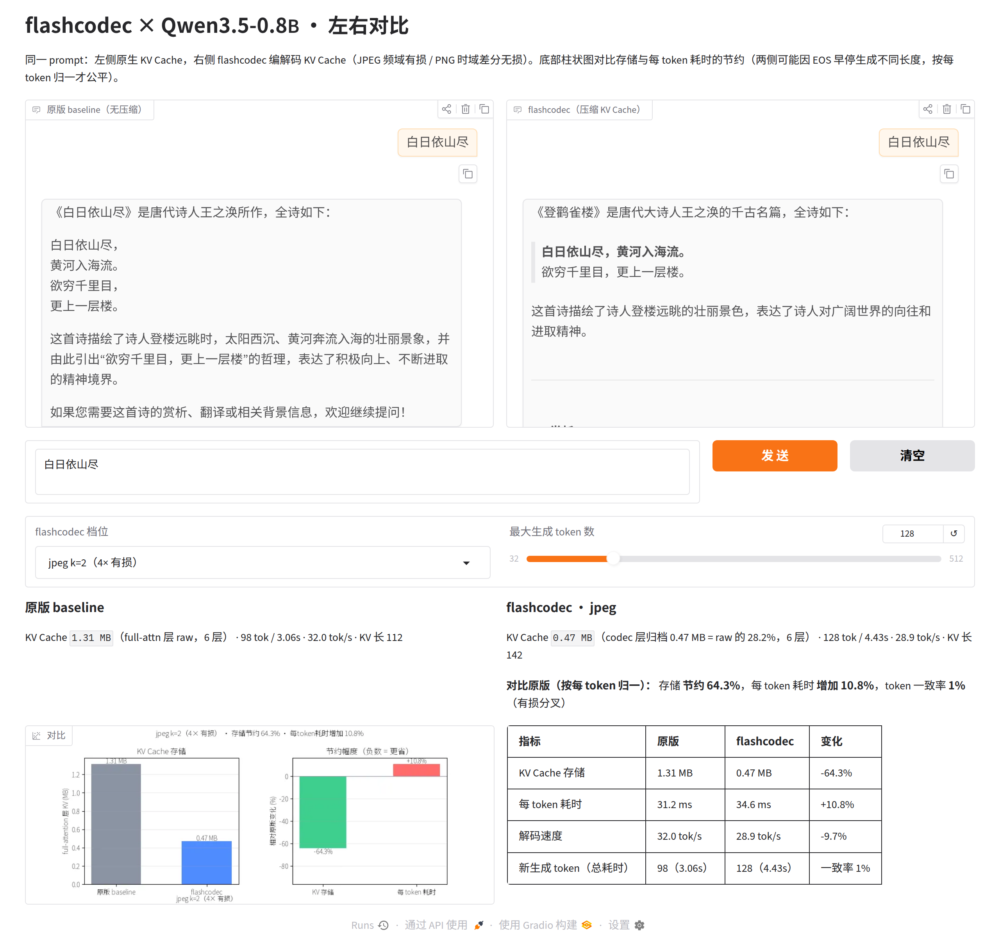

# flashcodec

> Compressing Transformer KV Cache tensors as **high-dimensional multimedia image signals**.

[English](README.md) | [简体中文](README.zh-CN.md)

Conventional LLM research treats hidden-space tensors as isolated scalar
factors. flashcodec observes that the seq axis of a `(B, H, S, D)` KV tensor
behaves like the rows/columns of a high-dimensional image — adjacent token
representations are autocorrelated, energy concentrates in low frequencies, and
first-order differences shrink in variance (how strongly depends on the model,
layer and tensor: the measured real-KV statistics and the per-layer caveat are
in the Benchmarks section). Two classic
multimedia compression theories therefore transfer directly:

| Mode | Inspired by | Transform | Nature | Storage |
|---|---|---|---|---|
| `mode="jpeg"` | JPEG | Block-wise orthonormal 1D DCT-II, keep lowest K coeffs | **Lossy, frequency domain** | `K/r` (4×–8× less memory) |
| `mode="png"` | PNG | Per-block anchor (I-Token) + first-order deltas, Top-M pruning | **Lossless / near-lossless, time domain** | Dense, size-neutral; sparsity left to entropy coding |

`quant_bits=8` (jpeg only) stores the coefficients as int8 with a
per-(block, frequency) scale — a real byte-level saving on top of `K/r`:
**6.6% of raw KV at k=2 (15×), 46.9 dB PSNR**, versus 25% / 47.2 dB in fp32.

Math (block size `r`, operating axis `dim=-2`):

- **JPEG**: $X_{\text{blk}} \in \mathbb{R}^{r \times D}$, $C = M_{\text{enc}} X_{\text{blk}}$ with
  $M_{\text{enc}} \in \mathbb{R}^{K \times r}$, $M[j,n] = c_j \cos\frac{\pi}{r}(n+\tfrac12)j$,
  orthonormal rows ($K=r$ is per-block lossless); reconstruct $\hat X = M_{\text{enc}}^\top C$.
- **PNG**: $\Delta_i = x_i - x_{i-1}$ ($i \ge 1$), $x_0$ kept at full precision as the
  anchor; rebuild $\hat x_i = x_0 + \sum_{j=1}^{i} \Delta_j$ (`cumsum`, purely
  linear and autograd-differentiable). Autocorrelation implies
  $\mathrm{Var}(\Delta)/\mathrm{Var}(X) \approx 0.03$ (**30× variance collapse**,
  measured); after Top-M pruning the residual is nearly zero and sparse.

```
                    ┌────────────────────────────────────────────┐
  (B,H,S,D) ──append──▶  raw_buffer (tail < r, full fidelity)     │
                    │        │ r tokens accumulated, batched      │
                    │        ▼ archive (single GEMM, in-place     │
                    │             slice write into)               │
                    │  compressed_storage (capacity-doubled)      │
                    │   jpeg: coeffs (B,H,capacity,K,D)           │
                    │   png:  deltas (B,H,capacity,r-1,D)         │
                    │         + anchors (B,H,capacity,D)          │
                    └───────────────┬────────────────────────────┘
                                    │ read(): one decode of active
                                    │         region + raw tail
                                    ▼
                        reconstructed KV view (B,H,S,D)
```

Archives live in a **single geometrically-grown buffer** (std::vector-style:
start at 16 blocks, double on overflow). Each full block is one in-place
slice write — no re-allocation churn — and `read()` decodes **only the
newly archived blocks** (one batched GEMM / cumsum per new block, memoized
in an append-only reconstruction buffer) instead of re-decoding the whole
history on every decode step. (Fragmented per-block archive lists made
per-token decode ~170× slower at S=4096 due to kernel-launch overhead.)

## Causal-safety design

Only **complete blocks** are archived; the current incomplete block always
stays in `raw_buffer` at original precision. During incremental decoding, no
future perturbation can ever rewrite archived tensors (verified bitwise in
tests). On the lossless tier (`mode="png", keep_ratio=1.0`), step-by-step
decoded attention matches full-sequence attention within ≤1e-4.

## Installation

```bash
pip install -e ".[hf]"  # from source: torch>=2.0 (+ transformers>=5.20 for the HF backend)
```

Distribution name on PyPI: `flashcodec-kv` — the import name stays
`flashcodec`. (The bare `flashcodec` name there belongs to an unrelated
placeholder package, so don't `pip install flashcodec`.)

## Quick start

```python
import torch
from flashcodec import FlashCodecCache, apply_flash_codec

# 1) Native: a first-class transformers 5.x Cache backend (any CausalLM)
cache = FlashCodecCache(mode="jpeg", block_size=8, keep_freqs=2)  # 4×
#    int8 coefficients: same shape, 15× smaller archive (quant_bits=8)
cache = FlashCodecCache(mode="jpeg", block_size=8, keep_freqs=2,
                        quant_bits=8)                              # 15×
out = model.generate(input_ids, max_new_tokens=64,
                     past_key_values=cache, use_cache=True)
print(cache.get_seq_length(), cache.storage_bytes())

# 2) One-line hot patch: every generate() defaults to the codec cache
apply_flash_codec(model, mode="png", block_size=8, keep_ratio=1.0)
out = model.generate(input_ids, max_new_tokens=64)
# PNG lossless tier reproduces the unpatched model's tokens EXACTLY
from flashcodec import remove_flash_codec
remove_flash_codec(model)          # restore default behavior

# Materialization-free decode (coefficient-domain attention, no KV view):
apply_flash_codec(model, mode="jpeg", block_size=8, keep_freqs=2,
                  quant_bits=8, materialization_free=True)

# 3) Standalone (no transformers needed): direct cache manager
from flashcodec import CodecKVCache
cache = CodecKVCache(mode="jpeg", block_size=8, keep_freqs=2)
k, v = cache.forward(k_seq, v_seq)          # full-sequence fill
k, v = cache.decode_step(new_k, new_v)      # incremental decode
```

`FlashCodecCache` subclasses `transformers.cache_utils.Cache` (5.x layer
API): write/read replacement is converged at the `cache.update(k, v,
layer_idx)` interface — zero model surgery, works with any CausalLM
(Llama/Qwen/Mistral-style GQA included).

## Transformers integration (real-world tested on Qwen3.5-0.8B)

Hybrid architectures (e.g. Qwen3.5: 18 linear-attention layers + 6
full-attention layers) are handled automatically —
`FlashCodecCache.from_config(model.config)` attaches codec layers **only to
`full_attention` layers** and keeps native dynamic layers for everything
else (recurrent/conv states untouched). `apply_flash_codec` uses `from_config`
whenever a model config is available.

```python
from transformers import AutoModelForCausalLM, AutoTokenizer
from flashcodec import apply_flash_codec

model = AutoModelForCausalLM.from_pretrained("Qwen/Qwen3.5-0.8B",
                                             torch_dtype="bfloat16").cuda()
tok = AutoTokenizer.from_pretrained("Qwen/Qwen3.5-0.8B")
ids = tok("A quiet lake at dawn", return_tensors="pt").input_ids.cuda()

# One line — every generate() now runs on the codec cache
apply_flash_codec(model, mode="jpeg", block_size=8, keep_freqs=2)
out = model.generate(ids, max_new_tokens=48, do_sample=False)
```

Measured on Qwen3.5-0.8B (bf16, CUDA, 48 greedy tokens, `benchmarks/run_qwen_demo.py`):

| Tier | Storage vs raw KV | Output | Verdict |
|---|---|---|---|
| `png keep=1.0` | ~1.8× (fp32 deltas for exactness) | **bit-identical tokens to the unpatched model** | 100% fidelity baseline |
| `jpeg k=8 int8` | **55.5%** (~1.8×) | fluent, **100% token match** | safe lossy tier |
| `jpeg k=2` | **32.3%** (~3.1×) | fluent, 38.1% token match | lossy tier |
| `jpeg k=4` | 54.8% (~1.8×) | fluent, 49.2% token match | lossy tier |
| `jpeg k=2 int8` | **21.1%** (~4.7×) | fluent, 38.1% token match | lossy + int8 |

Hybrid-layer audit: `codec_layers=6/24` (full attention only), zero warnings.
Reproduce with `python benchmarks/run_qwen_demo.py` (offline; honors
`FLASHCODEC_MODEL` / `FLASHCODEC_NEW_TOKENS`).

dtype contracts (see `AGENTS.md`): PNG deltas are always fp32 (bf16
differences lose the bitwise-exactness the lossless tier promises); JPEG
coefficients and `read()` views stay in the stream's input dtype (SDPA
requires q/k/v dtype parity).

## Materialization-free decode attention

Every codec here is a **linear map along the seq axis**: the r tokens of a block
are `K_block = A @ S`, where `S` are the stored rows (DCT coefficients, or
anchor + deltas) and `A` is the synthesis matrix. So a decode query can attend
on `S` directly:

```
q . K[p] = (q . S^T) @ A[p]        out = (prob @ A) @ S
```

`codec_decode_attention(q, key_stream, value_stream)` implements this for one
new token (jpeg k<r, jpeg int8 and png; GQA grouping included). The `(S, D)`
reconstruction never exists, and the result matches the materialized path to
≤1e-6.

Measured (`benchmarks/bench_attention.py`, B=1, H_kv=8, H_q=16, D=64, fp32):

| seq | mode | materialized | coefficient-domain |
|---|---|---|---|
| 16384 | jpeg k=2 int8 | 0.20ms / 130MB | 0.30ms / **32MB** |
| 65536 | jpeg k=2 int8 | 0.86ms / 520MB | **0.46ms / 128MB** |
| 65536 | png keep=1.0 | 0.87ms / 520MB | 1.03ms / 272MB |

Scope: **decode only** (prefill still uses the view — the coefficient form would
explode the score tensor). png stores r rows per block, so it is numerically
supported but gains nothing; the win is jpeg `k < r`.

A **Triton split-K kernel** (`flashcodec/triton_attention.py`, flash-decoding
style: block chunks write partial max/sum/acc, a combine kernel merges them)
removes the intermediate tensors and the launch overhead. One layer, B=1,
H_kv=8, H_q=16, D=128, `jpeg k=2 int8` (`benchmarks/bench_attention.py --cuda`):

| seq | materialized | coefficient (torch) | coefficient (Triton) |
|---|---|---|---|
| 16384 | 0.20ms / 130MB | 0.34ms / 24MB | **0.10ms / 0MB** |
| 65536 | 0.89ms / 520MB | 0.43ms / 96MB | **0.17ms / 0MB** |

`apply_flash_codec(model, ..., materialization_free=True)` wires it into
transformers: the forward of standard Llama/Qwen-style attention modules is
wrapped (projection + RoPE unchanged, the attention output replaced), guarded to
single-token / batch-1 / eval / non-sliding layers, otherwise it falls back to
the original path. The prefill reconstruction is released on the first decode
step. `remove_flash_codec` restores everything.

End-to-end (`benchmarks/bench_e2e.py`, Qwen3-0.6B, 4096-token prompt + 32 new):

| tier | tok/s | peak | steady |
|---|---|---|---|
| baseline (raw KV) | 52.1 | 581MB | 0MB |
| codec k=2 int8, materialized | 44.2 | 1545MB | 1535MB |
| codec k=2 int8, materialization-free (Triton) | 40.3 | **642MB** | **122MB** |

**12.6× less steady memory** at ~9% slower decode than the materialized path
(per decode step at 4096 tokens: 22.8ms vs 21.7ms materialized, 17.8ms raw).
The remaining gap is the per-layer split/combine launch pair; a persistent
kernel would close it.

## Demo (side-by-side chat on Qwen3.5-0.8B)



Same prompt, two panels: native KV cache on the left, flashcodec on the
right (mode switchable: png lossless / jpeg k=1,2,4), with a bar chart of
storage & latency savings and a token-match table underneath.

```bash
pip install -e ".[demo]"   # gradio + matplotlib
python demo/qwen_gradio_chat.py    # Gradio side-by-side + savings chart
```

## Benchmarks (measured; B=2 H=8 S=2048 D=64, random-walk autocorrelated signal, fp32)

### Reconstruction quality (`benchmarks/bench_reconstruct.py`)

| Config | PSNR (dB) | cosine | Storage |
|---|---|---|---|
| jpeg r=8 k=1 (8×) | 42.95 | 0.99943 | 12.5% |
| jpeg r=8 k=2 (4×) | 47.22 | 0.99985 | 25.0% |
| jpeg r=8 k=4 (2×) | 51.66 | 1.00001 | 50.0% |
| jpeg r=8 k=2 int8 | 46.92 | 0.99983 | 6.6% |
| jpeg r=8 k=4 int8 | 50.89 | 0.99999 | 13.3% |
| png r=8 keep=0.5 | 50.11 | 0.99997 | 100% (sparsity → entropy coder) |
| png r=8 keep=1.0 | ~196 (fp rounding) | 1.00000 | 100% |

### Real KV statistics (real models, 512 tokens)

`bench_reconstruct` uses a synthetic random walk; real caches are messier.
Measured on real post-RoPE KV (`Var(Δ)/Var(X)` along the seq axis, and the
fraction of block energy kept by the lowest k=2 DCT coefficients of a block of
8):

| model / layer | tensor | Var(Δ)/Var(X) | energy in k=2 |
|---|---|---|---|
| Qwen3-0.6B L0 | K | 0.16 | 0.94 |
| Qwen3-0.6B L0 | V | 1.87 | 0.31 |
| Qwen3-0.6B L27 | V | 1.02 | 0.59 |
| Qwen3.5-0.8B L3 | K | 0.72 | 0.71 |
| Qwen3.5-0.8B L23 | V | 0.09 | 0.97 |

Values are frequently **anti**-correlated (ratio > 1), so "first differences
collapse the variance" is a property of smooth synthetic signals, not of every
real layer. Practical consequence: coefficient truncation (`k < r`) is a
per-layer decision — on a dense model (28 compressed layers) the error compounds
and quality collapses; use `k = r` + `quant_bits=8` there.

### Perplexity (`benchmarks/bench_ppl.py`; 16 × 512 tokens, bf16, local corpus)

| tier | Qwen3.5-0.8B (6/24 layers) | Qwen3-0.6B (28/28 layers) | storage |
|---|---|---|---|
| baseline | 22.4803 | 16.7931 | 100% |
| png keep=1.0 | 22.4803 (+0.000) | 16.7931 (+0.000) | 188% |
| jpeg k=8 (lossless basis) | 22.4877 (+0.007) | 16.8058 (+0.013) | 100% |
| **jpeg k=8 int8** | **22.4991 (+0.019)** | **17.1348 (+0.34)** | **~52%** |
| jpeg k=4 | 22.3010 (−0.18) | 470.85 (+454) | 50% |
| jpeg k=2 | 24.0566 (+1.58) | 6485.5 (+6469) | 25% |
| jpeg k=2 int8 | 24.0590 (+1.58) | 8118.5 (+8102) | 13% |

The hybrid result is good because only 6 of 24 layers carry a codec (the 18
linear-attention layers keep their native state); the dense model shows why
per-layer truncation must not be applied blindly.

### Per-layer budgets (`benchmarks/bench_adaptive.py`, Qwen3-0.6B, 6 × 512 tokens)

Calibration: compress one layer at a time to k=4, measure the perplexity damage,
then give the cheapest half of the layers k=4 and leave the rest at k=r (75%
storage):

| schedule | ppl | Δppl | storage |
|---|---|---|---|
| baseline (k=r) | 18.9786 | — | 100% |
| uniform k=6 | 48.0531 | +29.07 | 75% |
| adaptive (14 layers k=4) | 40.8309 | +21.85 | 75% |
| uniform k=4 | 710.22 | +691.24 | 50% |
| uniform k=r int8 | 19.3627 | +0.38 | 50% |

Calibration beats a uniform budget at the same storage (−15%), but the damages
are **super-additive** (the cheapest 14 layers add up to +22 ppl although no
single one costs more than +0.5), and int8 at 50% is far better. Use
`per_layer={idx: {"keep_freqs": ...}}` when a budget forces structural
truncation; otherwise prefer `quant_bits=8`.

### Cache footprint & latency (`benchmarks/bench_vram.py`, CPU)

| seq | Mode | storage | ratio | fill | read |
|---|---|---|---|---|---|
| 4096 | jpeg k=2 | 4.0MB | 0.25 | 7.4ms | 0.1ms |
| 16384 | jpeg k=2 | 16.0MB | 0.25 | 31.6ms | 0.3ms |
| 65536 | jpeg k=2 | 64.0MB | 0.25 | 125.0ms | 3.2ms |
| 4096 | jpeg k=2 int8 | 1.1MB | 0.07 | 11.2ms | 0.1ms |
| 16384 | jpeg k=2 int8 | 4.3MB | 0.07 | 44.0ms | 0.4ms |
| 65536 | jpeg k=2 int8 | 17.0MB | 0.07 | 180.5ms | 3.2ms |
| 65536 | png keep=1.0 | 256.0MB | 1.00 | 224.1ms | 3.2ms |

CPU timings vary ~±20% between runs (min of 3); the storage/ratio columns are
exact. `read` = materialize the view and touch it (`.sum()`, so the number is the
consumer cost, not just kernel launch). Decoding is memoized per archived block,
so `read` costs one decode per **new** block instead of re-decoding the whole
history on every decode step (previously 38.7ms / 71.9ms in the last two rows).

PNG does not shrink dense storage (the fate of a lossless tier) — its value is
the 30× variance collapse plus near-zero sparse residuals after Top-M, i.e.
ideal input for an entropy coder (none is bundled).

## Repository layout

```
flashcodec/
├── flashcodec/
│   ├── __init__.py        # apply_flash_codec / CodecKVCache / JPEGCodec / PNGCodec
│   ├── codecs/jpeg.py     # DCT-II basis, project/reconstruct (pure GEMM, no loops)
│   ├── codecs/png.py      # anchor + first-order delta, cumsum, Top-M filter
│   ├── cache.py           # CodecKVCache: raw tail + capacity-doubled archives
│   ├── attention.py       # materialization-free decode attention (coefficient domain)
│   └── patch.py           # one-line hot patch: cache-level injection (HF Cache duck-typing)
├── tests/                 # jpeg / png / causal / attention suites (standalone scripts)
├── benchmarks/            # storage + PSNR/cosine + perplexity benchmarks
├── demo/                  # Gradio side-by-side chat
├── images/                # README screenshots
├── .github/workflows/     # CI: CPU tests + transformers integration
├── CHANGELOG.md
├── pyproject.toml
└── README.md
```

## Tests

```bash
python tests/test_jpeg.py           # orthonormality, k=r lossless, k=2 cosine>0.99, K monotone
python tests/test_png.py            # lossless maxdiff<1e-6, variance ratio printed, differentiable
python tests/test_causal.py         # zero future leakage, incremental vs full ≤1e-4,
                                   # memoized read == full decode, exact + repeatable crop,
                                   # beam-search batch gather
python tests/test_hf_integration.py # native transformers 5.x generate: explicit cache / hot patch /
                                    # PNG lossless exact tokens / 70-token multi-block stability /
                                    # beam search + crop exactness against the unpatched model /
                                    # per-layer schedule
python tests/test_attention.py      # coefficient-domain decode attention matches the materialized
                                    # path (jpeg / int8 / png, GQA); never builds the KV view
```

## Boundaries (honest list)

- Research prototype: `read()` materializes the full reconstructed view for
  attention; memory gains are at the **cache storage layer** (table above);
  end-to-end benefits require combining with materialization-free kernels
  (flash-attention style). That view is memoized and reused across decode
  steps, so steady-state memory = archive + one raw-KV-sized view.
- Full-sequence `forward(seq)` prefill compresses complete blocks directly, so
  mid-block attention sees the block-level reconstruction (within-block
  approximation); the incremental `decode_step` path has no such issue.
- Compressed tensors are dense layouts; PNG Top-M sparsity is not yet wired to
  an entropy coder. (Packing sparse png alone was measured to be a wash: the
  fp32 delta values dominate, and on bf16 input the packed form can be *larger*
  than raw — delta quantization has to come first.)
- Coefficient truncation (`k < r`) is a per-layer decision: on a dense model
  every layer is compressed and the error compounds (measured: Qwen3-0.6B
  perplexity 16.8 → 6486 at k=2). Use `k = r` + `quant_bits=8` there (~52%
  storage, +2% ppl) and reserve aggressive ratios for hybrid models where only
  the full-attention layers carry a codec.
- Same lineage as the v4.2 prototypes inside
  [Mini-Architecture](https://github.com/aifeifei798/Mini-Architecture)
  (there: per-position view semantics for cross-layer KV reuse; here:
  standard cache storage semantics).

## License

[MIT](LICENSE)
